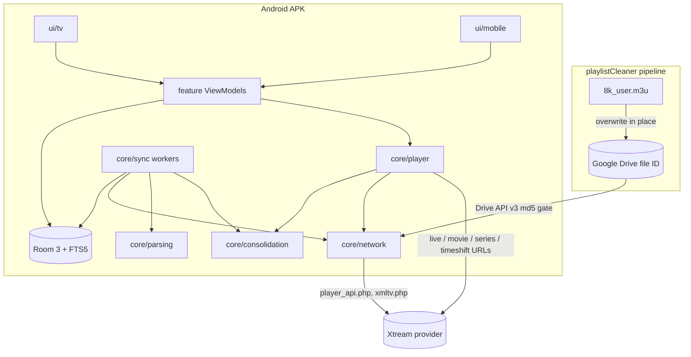
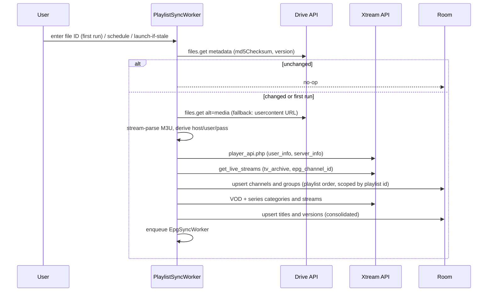
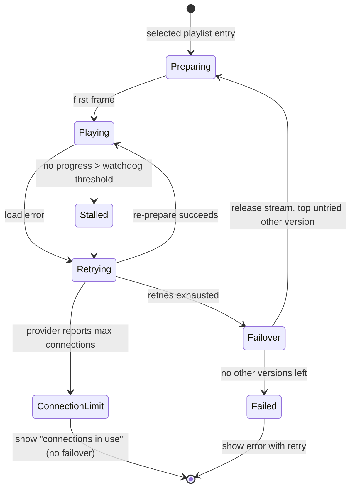

# feat: Android IPTV player for Fire TV and mobile

**Current implementation:** `playlistCleaner/android` on `feat/android-player`, branded **8TV Player**. The original implementation units below retain their planning-era path conventions. The session addenda record later scope, current behavior and remaining verification; where they differ from original requirements (notably R5 and device support), they supersede them.

## Summary

This plan builds one native Kotlin APK that runs on Fire OS Fire TV devices and Android phones. The user enters only a Google Drive file ID. The app downloads the personalized playlist produced by this repo's pipeline and derives the Xtream account from it. Further playlists can be added from a Drive file ID or an M3U URL. It then provides:

- Live TV with an EPG and catch-up.
- Movies and series pulled from the Xtream API.
- Live channels shown exactly as each playlist lists them, with up to five other versions of the same channel one step away.
- Duplicate movies and series merged into one entry with a language and quality picker.
- Content from each playlist grouped under that playlist's name.
- A Media3 player tuned for low-buffer live and 4K playback.

---

## Problem Frame

Typical IPTV players make each user paste a playlist URL and separately configure an EPG source. That is awkward on a Fire TV remote and breaks whenever the provider changes the playlist. This repo already produces a curated, per-user playlist (`8k_<username>.m3u`) and can overwrite it on Google Drive in place. The file ID therefore stays stable across pipeline runs (`playlistCleaner:upload_to_gdrive.py`, `update_file` path used by `--backup` with `overwrite_existing`), so a Drive file ID is a durable handle a user can type once.

The playlist is live-only. All 15,433 entries are `/live/<user>/<pass>/<id>.ts` across 130 groups, with one host and one account per file. Movies and series must therefore come from the Xtream API using the credentials embedded in the playlist.

The catalog is full of duplicates:
- 984 `tvg-id`s are shared by more than one live channel (variants such as "4K", "(1080p50)", "(Backup)").
- Provider VOD lists typically repeat titles per language and quality.

287 channels carry `catchup-type="xc" catchup-days="3"`, which the user wants playable from the EPG.

Users may also hold more than one provider or playlist. They need to add them side by side and always see which playlist a channel or title comes from.

---

## Requirements

**Onboarding and data refresh**
- R1. The user onboards by entering only a Google Drive file ID; no Google sign-in.
- R2. The app downloads the playlist, derives Xtream host/username/password from its URLs, and stores the ID and credentials encrypted.
- R3. The app refreshes the playlist on a schedule and on launch when stale. It re-downloads only when the Drive file changed. It keeps the last good copy when a refresh fails.
- R4. Group order follows the playlist order; emoji and UTF-8 group names render correctly.

**EPG and catch-up**
- R5. A default EPG works with zero setup. Updated: new playlists default to the curated override, with an opt-out to provider `xmltv.php`; provider data fills unmatched channels where available. See the session addendum for existing playlists.
- R6. The user can override the EPG with their own XMLTV URL. The app reports the match rate and falls back to the provider EPG for unmatched channels.
- R7. For catch-up-enabled channels, past programmes within the channel's archive window are marked in the EPG and playable from the start.
- R8. During live playback of a catch-up channel, the user can restart the current programme.

**Live playback**
- R9. Live playback starts fast and recovers from stream drops without user action.
- R10. 4K content (HEVC, HDR, 50/60fps) plays smoothly on supported Fire TV 4K / 4K Max devices.
- R11. Live channels appear exactly as the playlist lists them, with no merging or hiding. While watching, the user can switch to up to five other versions of the same channel from the same playlist, from any group. They are ranked 4K > FHD > HD > SD, with backups last. On a fatal error the app switches to the top untried other version.

**Movies and series**
- R12. Movies and series are browsable by provider category, with artwork and details.
- R13. Duplicate titles across languages and qualities are merged into one title with a version picker.
- R14. The default version follows a user-configurable language preference list (English first by default) and then quality (4K > FHD > HD > SD).
- R15. Each title's detail screen has a language and quality filter over its versions.
- R16. Series navigate season, then episode, then next episode, keeping the chosen language and quality when auto-advancing.

**Library features**
- R17. Global search covers live channels, movies and series.
- R18. Favourites (channels and titles) and recently watched channels.
- R19. Continue watching with resume position for movies and episodes.
- R20. A parental PIN hides chosen groups and categories.

**Platform**
- R21. One APK serves Fire TV (D-pad, leanback launcher) and phones (touch), with layouts appropriate to each.
- R22. Account status (expiry date, active/max connections) is visible per playlist. Connection-limit failures produce a specific message instead of a generic error.

**Multiple playlists**
- R23. The user can add further playlists, each from a Drive file ID or an M3U URL, and give each a name.
- R24. When adding a playlist, the user chooses whether to process its Xtream account (Movies, Series, provider EPG, catch-up). If not, only its live channels load.
- R25. Live, Movies and Series group content under each playlist's name.
- R26. Content is never merged across playlists. Other versions of live channels and VOD consolidation stay within one playlist.
- R27. The user can rename, refresh, reconfigure or remove a playlist. Removing one deletes only that playlist's data.

**Post-test refinements (added 2026-10-31 after the first device test)**
- R28. The screensaver never starts while any player is playing, buffering or reconnecting; it may start when playback is paused, ended or closed.
- R29. Live and Guide are one "Live TV" destination: group rail on the left, guide grid for the selected group on the right. Selecting a channel name plays it live; selecting a programme keeps the guide behaviour (catch-up, restart, details).
- R30. The app opens on Live TV (TV and phone); first run without playlists still shows onboarding. Home remains in the menu.
- R31. "Series" is renamed "TV Shows" everywhere user-visible.
- R32. Movies and TV Shows show, in order: Trending (TMDB weekly trending, refreshed at most daily, only titles present in the user's catalog), Continue watching (movies: started but not completed; TV Shows: show with an episode in progress or a next unwatched episode), then all titles of that kind.
- R33. Xtream VOD categories are no longer shown. The full title list defaults to Recently added, with a per-section sort switch: Recently added, A–Z, Release year.

**Performance and UX redesign (added 2026-11-01 after the second device test: the U18 build made the whole Fire TV sluggish)**
- R34. The app must not degrade the Fire TV: UI stays at 60 fps while browsing, and background sync never makes the device feel slow. Targets are set from measurements on the user's Fire TV.
- R35. Movies and TV Shows browsing uses only work the device can afford: no whole-catalog grouping or sorting on the device at browse time; data is loaded lazily per page or category from the database or the Xtream API.
- R36. The Live TV guide follows the TiviMate layout (reference: tivimatenederland.com hidegroup screenshot): selected programme details and a live preview at the top, a dense channel guide below with logo, number and name, and groups in a side panel that can be hidden.
- R37. Text and spacing are smaller and denser, sized correctly on 4K screens (TiviMate density as the reference).
- R38. Changing channel shows the channel info overlay immediately instead of a loading spinner; buffering is indicated subtly.
- R39. While watching live, one key/button jumps back to the previously viewed channel (TiviMate-style "last channel" shortcut).
- R40. All on-demand playback (movies and episodes) offers audio-language and subtitle selection from the stream's tracks.

---

## Scope Boundaries

- No changes to the Python pipeline. Sharing the Drive file as "anyone with the link" is a one-time manual step, documented in this repo.
- No recording/PVR, multi-profile, casting, or picture-in-picture. Multiple playlists are in scope; separate user profiles are not.
- No merging of live channels into one entry, and no merging of channels or titles across playlists.
- No Vega OS build. Vega devices cannot install APKs.
- No content is bundled or suggested by the app. It plays only what the user's playlist points to.

### Deferred to Follow-Up Work

- Amazon Appstore submission (sideload via Downloader is the v1 distribution route).
- Pipeline emitting machine-readable variant/quality metadata to replace app-side heuristics.
- Optional FFmpeg audio extension for codecs the device cannot decode or pass through (local build plus licence review).
- Remote config or crash reporting (must not leak stream URLs when added).
- Sharing favourites and watched status between devices on the same network. Options below, recorded 2026-11-14; no option chosen.

#### Cross-device sync of favourites and watched status (options, not started)

Current state: personal data lives only in each device's Room tables (`favourite`, `playback_progress`, `title_pick`, `last_channel`, `recent_channel`, `title_override` in `android/core/database/src/main/kotlin/app/playlistplayer/core/database/entity/UserDataEntities.kt`). Rows are keyed by the local auto-increment `playlistId`, which differs per device. Channel keys `s:<streamId>` are stable across devices for Xtream; `o:<ordinal>` keys (plain M3U) are not stable if the playlist order changes. Merged `VodTitle.key` values match when both devices index the same playlist version.

| Option | How | Pros | Cons |
|---|---|---|---|
| 1. Export / import | Settings action shows a QR / 6-digit code; the other device pulls a one-off snapshot over the LAN. | Smallest build; no server or background work. | One-off copy; watched state drifts again. |
| 2. Peer-to-peer LAN sync | Each app advertises via Android NSD (mDNS, available on API 25) and runs a small embedded HTTP server; paired devices exchange changes since last sync on start, resume and after changes. | No extra hardware. | Both devices must be running; Fire TV kills background apps, so sync happens only while open. Embedded server, pairing and N-way merge make it the largest build. |
| 3. Home sync service | Small container next to the pipeline's existing Docker deployment; devices push and pull deltas on start, resume and after changes. | Always available; server is the authority, so merging is simplest; a sleeping stick catches up on next launch; fits the repo's Docker target. | Needs an always-on host (NAS, Pi or PC). |
| 4. Google Drive appDataFolder | Sync a small JSON file in Drive's hidden app folder. | Works off-LAN too. | Needs Google OAuth sign-in on Fire TV (awkward); not LAN-only. |

Foundations any option needs:
- Stable cross-device playlist key: a hash (for example SHA-256) of the SecureStore source reference (Drive file id / M3U URL). Never send the raw value; it is a secret.
- Tombstones: removing a favourite currently deletes the row, so other devices never learn of it. Keep a deleted flag plus timestamp.
- Last-write-wins per row: `playback_progress` and `title_pick` already have `updatedAt`; `favourite` only has `addedAt` and needs `updatedAt`. Fire Sticks use network time, so clock skew is acceptable.
- Scope: sync favourites, progress/watched and version picks. Keep last channel and recent channels per device. `title_override` is optional.
- Pairing before any exchange. Payloads carry only the keys above, never credentials or URLs.
- Profiles: deriving the key from each user's own Drive file means one person's devices sync together and stay separate from other household members. This fits `replace_credentials_multi.py` per-user playlists.

Recommendation at the time of writing: option 3 if an always-on host exists, otherwise option 2. Option 1 could ship first as a stepping stone, because options 2 and 3 need the same tombstones and stable playlist key.

Open questions for the user:
- Is there an always-on machine on the network that can run a container?
- Should favourites be shared only between one person's devices, or across different users' playlists?

---

## Context & Research

### Relevant Code and Patterns (this repo)

- `playlistCleaner:replace_credentials_multi.py` writes `8k_<username>.m3u`. Every URL embeds that user's credentials, so one Drive file per user is the security boundary.
- `playlistCleaner:upload_to_gdrive.py` (`_upload_file_internal`, `update_file`) updates an existing file by name, preserving the file ID. It sets no sharing permissions.
- `playlistCleaner:data/config/group_titles_with_flags.json` sets group order. The app reflects order from the file and never re-sorts groups.
- Playlist attributes observed: `CUID`, `tvg-id` (14,543/15,433 present), `tvg-name`, `tvg-logo`, `group-title`, `catchup-type`, `catchup-days`, `tvg-chno` (28). There is no `#EXTM3U url-tvg` header.

### External References

- Media3 release notes (1.11.x stable at plan time; 1.12 adds a Fire TV AC-3 freeze workaround): https://developer.android.com/jetpack/androidx/releases/media3
- Media3 live streaming (live offset/speed control applies to HLS/DASH, not progressive TS): https://developer.android.com/media/media3/exoplayer/live-streaming
- Media3 network stacks (OkHttp/Cronet Embedded where Play Services is absent): https://developer.android.com/media/media3/exoplayer/network-stacks
- Android TV memory guidance (buffer caps, low-RAM devices): https://developer.android.com/training/tv/playback/memory
- Compose for TV (tv-material stable; Tv lazy layouts removed in favour of foundation lazy layouts): https://developer.android.com/training/tv/playback/compose
- Room 3.0 (KSP-only, `@Fts5`): https://developer.android.com/jetpack/androidx/releases/room3
- Fire TV device specs and Fire OS versions: https://developer.amazon.com/docs/device-specs/device-specifications-fire-tv-streaming-media-player.html and https://developer.amazon.com/docs/fire-tv/fire-os-8.html
- Fire TV 4K tunnel mode and HDMI mode switching: https://developer.amazon.com/docs/fire-tv/4k-tunnel-mode-playback.html and https://developer.amazon.com/docs/fire-tv/4k-apis-for-hdmi-mode-switch.html
- Drive API resource keys and `files.get`: https://developers.google.com/drive/api/v3/resource-keys
- Xtream Codes / XUI.one player API (community docs; no official spec): https://drm-free.duckdns.org/thegame_1980/xui-one-api-docs/src/branch/main/xtream-codes-player-api-documentation.md
- Catch-up timeshift semantics (start time in server timezone): https://uniplayer.net/docs/specs/catchup/
- Vega OS devices cannot sideload APKs (news): https://www.aftvnews.com/these-are-the-fire-tvs-that-dont-support-sideloading-or-downloader-due-to-vega-os/

---

## Key Technical Decisions

- **Native Kotlin with Media3, not cross-platform:** playback quality on Fire TV is the top requirement. Media3 gives direct control of load control, extractors, tunneling and error handling, which Flutter/RN players hide.
- **Google Media3, not Amazon's ExoPlayer port:** the port is frozen at ExoPlayer 2.18.7, and Amazon's own Fire OS 14 guidance points to Media3. Pin the 1.11.x line and move to 1.12 once stable for the Fire TV AC-3 fix.
- **minSdk 25, Fire OS 6/7/8:** one APK also supports Android 7.1+ phones; the optimized release still requires device acceptance. Vega OS devices (Stick 4K Select, newer 2026 sticks) cannot run APKs and are out of scope.
- **One APK, two UI trees over shared ViewModels:** tv-material on TV and material3 on phone, selected at runtime by `UiModeManager`/leanback feature. Google advises against mobile Material on TV, and a shared presentation layer keeps behaviour identical.
- **Room 3 with `@Fts5` as the single source of truth:** 15k channels, large VOD lists and a multi-day EPG cannot live in heap on 1–2 GB devices. Everything streams into Room and UI pages from it. Greenfield means no Room 2 migration cost.
- **Drive download via Drive API v3 with a restricted API key, usercontent URL as fallback:** the metadata call returns `md5Checksum`/`version`, so refresh only downloads when the pipeline overwrote the file. The legacy `uc?export=download` endpoint is deprecated. The key is restricted to the Drive API and the app's package/signing SHA-1.
- **Credentials and file ID encrypted with an Android Keystore key, held in DataStore:** do not use the deprecated `androidx.security:security-crypto`. Stream URLs are never shown in UI or logs; a single redaction utility is used by all logging.
- **Provider `xmltv.php` is the default EPG, imported by a streaming pull-parser:** use gzip sniffing and filter by playlist channels and by a time window of now − max(catchup-days) to now + 2 days. Xtream `get_short_epg` backfills now/next on demand. This needs zero configuration and stays inside low-RAM budgets.
- **Consolidation is a pure-Kotlin module with table-driven tests:**
  - Live channels are never merged; the playlist decides what is listed. An other-versions lookup finds entries in the same playlist with the same `tvg-id` and normalized base name, in any group, and returns the top five by the comparator. Entries with an empty `tvg-id` match only on an identical normalized name. "+1" channels are never other versions.
  - Movies are keyed by `tmdb_id` when present, else normalized title + year. Titles are never merged across differing years, or across movies and series.
  - Users can split or merge VOD titles manually.
  - All matching is scoped to one playlist.
- **Version ranking is a single ordered comparator:** manual per-title pick, then the user's language list (default English first), then quality (4K > FHD > HD > SD), then non-backup over backup. The same comparator drives the VOD default pick and picker order, the order of other live versions, the failover target and next-episode continuity.
- **Playlist is the top-level scope for all data:** every channel, title, programme, favourite, progress record and override carries a playlist id. Sync, account status and connection limits are per playlist, so playlists stay independent and removing one is a scoped delete.
- **Playlist sources behind one interface:** a Drive source (Drive API md5 gate) and an M3U URL source (conditional GET with ETag/Last-Modified). An M3U URL may itself carry credentials (`get.php?username=&password=`), so it is stored encrypted like the Drive ID.
- **Xtream processing is opt-in per playlist:** it is chosen when the playlist is added and can be changed later. It is off when the playlist's URLs are not Xtream-shaped. Without it, the playlist is live-only. Its guide comes only from an EPG override URL, and it has no catch-up.
- **Keep-awake is tied to player state, not to screens:** one shared helper sets `keepScreenOn` while the player state is Preparing, Playing, Stalled, Retrying or Failover, and clears it otherwise. Fire TV's screensaver respects this flag.
- **TMDB for Trending only, matched to the catalog:** TMDB v3 `trending/{movie|tv}/week` with a build-time API key (`tmdb.apiKey` in `local.properties`, like the Drive key). Matching uses the provider's `tmdb` id, falling back to normalized title + year. TMDB never adds titles the provider lacks. Missing key or network failure hides the row. TMDB terms require a visible "Powered by TMDB" credit.
- **Fire OS 6 was revisited:** earlier API 25 support was reverted due to sluggish UI; the user later reported stable usage on a separate debug build and chose a unified API 25 release. See the 2026-11-14 addendum for release-test status.
- **Live as progressive `.ts` by default, HLS when the server allows and the user opts in:** `.ts` starts faster with no playlist round-trips. HLS adds live-window recovery on flaky networks. Format comes from `user_info.allowed_output_formats`.
- **Low-latency live buffer profile plus an app-level reconnect watchdog:**
  - Media3 live-speed control does not apply to progressive TS. Buffer-free behaviour comes from a tuned `DefaultLoadControl` (short start threshold, bounded max buffer scaled by device RAM) and a custom `LoadErrorHandlingPolicy` with long retry.
  - A watchdog re-prepares on stall.
  - Version failover happens only after retries are exhausted.
- **No live pre-buffering or parallel probing:** Xtream `max_connections` is often 1, and any preload or probe would consume it. Failover releases the current stream before opening the next.
- **SurfaceView output, display-mode switching via `preferredDisplayModeId`, tunneling as an opt-in setting:** SurfaceView gives correct HDR and frame timing. `Surface.setFrameRate` variants need API 30/31, which Fire OS 7 lacks. Tunneling is device-specific.
- **Catch-up URLs built by a strategy interface:** two variants, path-style `/timeshift/...` and `timeshift.php`. The start time is converted to `server_info.timezone`, with a user ±hours offset for misconfigured panels. Seeking inside an archive re-requests the URL with a new start when the server does not support range seeking.

---

## Open Questions

### Resolved During Planning

- Language handling: a global ranked language list (English first by default) plus a per-title language/quality filter and remembered manual pick (user answer).
- v1 includes search, favourites, continue watching and parental PIN (user answer).
- Minimum devices: Fire OS 6/7/8 devices and Android 7.1+ phones; phone and optimized Fire OS 6 release acceptance remain open (Vega exclusion from research).
- Drive access: link-shared file, no Google sign-in (user answer).
- Live channels: never merged. The playlist decides what is listed, and up to five other versions of the same channel are offered (user answer).
- Multiple playlists: added from a Drive file ID or an M3U URL, Xtream processing optional per playlist, content grouped under each playlist's name, and no merging across playlists (user answer).
- Fire OS 6: supported by the unified API 25 build after the later debug-device trial; release acceptance remains open.
- TMDB: build-time key; weekly trending list; full list default "Recently added" with A–Z / Release year switch (user answers).
- Home stays in the menu; Live TV becomes the start screen on TV and phone (agent default, user may revisit for phone).
- Drive file ID stability: preserved across pipeline uploads because `--backup` updates in place.

### Deferred to Implementation

- Provider facts to measure in the U1 spike:
  - whether `get_vod_streams` carries `tmdb`/`tmdb_id`
  - `allowed_output_formats`
  - `server_info.timezone` and whether timeshift honours it
  - `get_vod_streams` / `xmltv.php` sizes
  - whether archive URLs support Range seeking.
- Exact `DefaultLoadControl` numbers per device class, tuned against measured zap time and rebuffer counts on real hardware.
- Whether eager full-VOD sync or lazy per-category sync is used. This depends on the measured response size.
- Whether each older Fire TV model meets performance expectations on its current firmware; Fire OS 6 is now within minSdk.
- GCP project for the API key. The repo already has an OAuth client (`playlistCleaner:data/config/gdrive_credentials.json`), so a project exists. Confirm which project hosts the restricted key.

---

## Output Structure

```text
playlist-player-android/
  app/                        # single APK: DI, manifest (TV + phone), form-factor switch, navigation
  core/model/                 # domain types (Playlist, Channel, Title, Version, Programme)
  core/database/              # Room 3 schema, DAOs, FTS
  core/network/               # Drive client, Xtream client, OkHttp setup, redaction
  core/parsing/               # M3U streaming parser, XMLTV pull-parser
  core/consolidation/         # title/channel parsing, grouping, version comparator (pure Kotlin)
  core/player/                # Media3 player factory, load control, watchdog, failover, catch-up URLs
  core/sync/                  # WorkManager workers: playlist, Xtream catalog, EPG
  feature/onboarding/
  feature/playlists/
  feature/live/
  feature/epg/
  feature/vod/
  feature/search/
  feature/settings/
  ui/tv/                      # tv-material screens
  ui/mobile/                  # material3 screens
  baselineprofile/
docs/
  provider-spike.md
  distribution.md
```

---

## High-Level Technical Design

> The diagrams show the intended shape. Prose in Key Technical Decisions and the units is authoritative where they differ.

### Component topology



### Sync pipeline (onboarding and refresh)



### Live playback, reconnect and failover



### Catch-up URL construction

```text
programme (UTC start/stop from EPG)
  -> eligible if the entry (or one of its other versions) has archive and now - start <= archive days
  -> start_local = convert(start, server_info.timezone) + user offset hours
  -> duration_min = ceil((stop - start) / 60s)
  -> strategy.build(host, user, pass, stream_id, start_local, duration_min)
       PathStrategy:  /timeshift/{user}/{pass}/{duration}/{YYYY-MM-DD:HH-MM}/{id}.ts
       PhpStrategy:   /streaming/timeshift.php?username=&password=&stream=&start=&duration=
```

---

## Implementation Units

### Phase 1 — Foundations

### U1. Provider validation spike

**Goal:** Measure the provider facts that the design depends on before building against assumptions.

**Requirements:** R5, R7, R10, R13

**Dependencies:** None

**Files:**
- Create: `docs/provider-spike.md`
- Create: `core/network/src/test/resources/fixtures/` (redacted, trimmed sample responses: `user_info`, `get_live_streams`, `get_vod_streams`, `get_series_info`, `get_short_epg`, XMLTV excerpt)

**Approach:**
- Using a throwaway script or REPL against the real account, record:
  - `allowed_output_formats`, `max_connections`
  - `server_info.timezone`
  - presence and type of `tmdb`/`tmdb_id`
  - full `get_vod_streams` and `xmltv.php` sizes
  - Content-Length/Range support on a timeshift URL
  - whether path-style or `timeshift.php` catch-up works
- Play one catch-up programme and confirm which timezone interpretation lands on the right programme.
- Redact host, username and password from every fixture before committing.

**Test expectation:** none -- research spike; it produces the fixtures later units test against.

**Verification:** `docs/provider-spike.md` answers each deferred provider question. The fixtures contain no credentials or hostnames.

### U2. Project scaffold and platform configuration

**Goal:** A buildable multi-module app that installs and launches on Fire TV and phone and selects the right UI tree.

**Requirements:** R21

**Dependencies:** None

**Files:**
- Create: `settings.gradle.kts`, `build.gradle.kts`, `gradle/libs.versions.toml`
- Create: `app/src/main/AndroidManifest.xml`, `app/src/main/res/xml/network_security_config.xml`, `app/src/main/res/drawable/banner.png`
- Create: `app/src/main/kotlin/.../FormFactor.kt`, `app/src/main/kotlin/.../MainActivity.kt`
- Test: `app/src/test/kotlin/.../FormFactorTest.kt`

**Approach:**
- minSdk 25; target SDK 36. APK signature v2 (AGP does not emit v1 at minSdk 25); uncompressed, aligned resources per Fire OS guidance.
- Manifest declares `LEANBACK_LAUNCHER` and `LAUNCHER`, `leanback` and `touchscreen` features `required=false`, and a 320×180 banner.
- The network security config permits cleartext, because provider hosts are `http://` and only known at runtime. Drive and other HTTPS calls stay HTTPS.
- DI (Hilt) and module skeletons per Output Structure.

**Test scenarios:**
- Happy path: a TV ui-mode configuration selects the TV tree; a normal phone configuration selects the mobile tree.
- Edge case: a phone with a connected keyboard or D-pad still selects mobile; TV detection relies on ui mode or the leanback feature, not on input type.

**Verification:** The debug APK installs via ADB on a Fire TV 4K Max and appears in the Fire TV apps row with its banner. The same APK launches on an Android phone.

### U3. Playlist acquisition, parsing and secure storage

**Goal:** Turn a Drive file ID into channels in Room, with change detection, credential derivation and failure tolerance.

**Requirements:** R1, R2, R3, R4

**Dependencies:** U2

**Files:**
- Create: `core/network/src/main/kotlin/.../drive/DriveClient.kt`, `core/network/src/main/kotlin/.../Redactor.kt`
- Create: `core/parsing/src/main/kotlin/.../m3u/M3uParser.kt`, `core/parsing/src/main/kotlin/.../m3u/AccountExtractor.kt`
- Create: `core/database/src/main/kotlin/.../` (entities: Playlist, Group, Channel, SyncState, all channel data keyed by playlist id; DAOs)
- Create: `core/sync/src/main/kotlin/.../PlaylistSyncWorker.kt`, `core/sync/src/main/kotlin/.../SecureStore.kt`
- Test: `core/network/src/test/kotlin/.../drive/DriveClientTest.kt`, `core/parsing/src/test/kotlin/.../m3u/M3uParserTest.kt`, `core/parsing/src/test/kotlin/.../m3u/AccountExtractorTest.kt`, `core/network/src/test/kotlin/.../RedactorTest.kt`, `core/sync/src/test/kotlin/.../PlaylistSyncWorkerTest.kt`

**Approach:**
- **Playlist scope:** every row written by this unit carries the playlist id. The first playlist is created at onboarding with a user-given name (default "My playlist").
- **DriveClient** does a metadata GET (`md5Checksum`, `version`, `size`), then `alt=media`. On API failure it falls back to `drive.usercontent.google.com/download?...&confirm=t`. It accepts an optional resource key. Errors are classified as NotFound, NotShared, QuotaExceeded, Network or Other.
- **M3uParser** streams line by line and preserves file order as the group/channel ordinal. It keeps UTF-8 names intact.
- **AccountExtractor** takes the majority host/user/pass across URLs. It flags (does not fail) when the playlist contains more than one account.
- **The worker** writes in batched transactions and swaps atomically, so the UI never sees a half-written playlist. On failure it keeps the previous data and records the failure for a "using cached copy from <date>" banner.
- Credential change on refresh invalidates the Xtream catalog sync state.

**Patterns to follow:** The pipeline's own playlist reading in `playlistCleaner:replace_credentials_multi.py` (attribute set and URL shape).

**Test scenarios:**
- Happy path: the fixture playlist parses to the expected channel count, group count and first-group order. Emoji group names round-trip unchanged.
- Happy path: the metadata md5 is unchanged from the stored value, so no media download happens.
- Edge case: an entry with a missing `tvg-id` or missing logo still parses; an `#EXTINF` with no following URL is skipped.
- Edge case: a playlist with a second host on a few lines uses the majority account and raises the mixed-account flag.
- Error path: a 404 maps to NotFound, a 403 `downloadQuotaExceeded` maps to QuotaExceeded, and an HTML response body maps to NotShared. Each leaves the previous playlist intact.
- Error path: the network drops mid-download, the transaction is not committed, and the previous channels remain queryable.
- Integration: a refresh with new credentials updates stored credentials and marks the VOD/EPG sync stale.
- Redaction: any URL containing `/live/u/p/` or `username=`/`password=` is masked by the Redactor.

**Verification:** Entering a real file ID on a device lists the groups in pipeline order. A forced refresh with an unchanged file makes no media request.

### U4. Xtream API client and catalog sync

**Goal:** For each playlist with Xtream processing enabled, fetch account status, live stream metadata (archive flags, EPG ids), and the VOD and series catalogs into Room.

**Requirements:** R7, R12, R22

**Dependencies:** U1, U3

**Files:**
- Create: `core/network/src/main/kotlin/.../xtream/XtreamClient.kt`, `core/network/src/main/kotlin/.../xtream/XtreamModels.kt`
- Create: `core/sync/src/main/kotlin/.../CatalogSyncWorker.kt`
- Create: `core/database/src/main/kotlin/.../` (entities: Title, TitleVersion, Series, Episode, Category, AccountStatus)
- Test: `core/network/src/test/kotlin/.../xtream/XtreamClientTest.kt`, `core/sync/src/test/kotlin/.../CatalogSyncWorkerTest.kt`

**Approach:**
- Use lenient decoding for numbers-as-strings, `""`/null, `tmdb` vs `tmdb_id`, and base64 EPG titles.
- Stream-decode large arrays straight into batched Room inserts. Never hold the full list in memory.
- `get_live_streams` is joined to playlist channels by stream id from the URL. It supplies `tv_archive`, `tv_archive_duration` and `epg_channel_id`. The playlist stays authoritative for which channels exist and their order.
- Series info (`get_series_info`) is fetched on demand when a series is opened and cached.
- Eager versus per-category sync follows the U1 size measurement.

**Test scenarios:**
- Happy path: the `user_info` fixture yields the expiry date, active/max connections and allowed formats; `server_info` yields the timezone.
- Edge case: `exp_date` null means "no expiry". `tmdb_id` as `""`, `0`, `"123"` or `123` normalizes to absent/absent/123/123.
- Edge case: `get_series_info` episodes keyed by season string ("1", "10") sort numerically.
- Error path: `auth: 0` or `status: Expired` surfaces an account-expired state and stops further catalog calls.
- Integration: a playlist channel whose stream id is missing from `get_live_streams` still plays live but has no archive flag.

**Verification:** After sync on a device, movie and series categories list with artwork, and channel archive flags match the playlist's `catchup-days` entries.

### U5. Consolidation engine

**Goal:** Find other versions of live channels, group VOD versions, and rank both with one comparator.

**Requirements:** R11, R13, R14, R15, R16

**Dependencies:** U1 (real sample names)

**Files:**
- Create: `core/consolidation/src/main/kotlin/.../TitleTokenizer.kt`, `core/consolidation/src/main/kotlin/.../AlternativeFinder.kt`, `core/consolidation/src/main/kotlin/.../TitleGrouper.kt`, `core/consolidation/src/main/kotlin/.../VersionComparator.kt`, `core/consolidation/src/main/kotlin/.../Overrides.kt`
- Test: `core/consolidation/src/test/kotlin/.../TitleTokenizerTest.kt`, `core/consolidation/src/test/kotlin/.../AlternativeFinderTest.kt`, `core/consolidation/src/test/kotlin/.../TitleGrouperTest.kt`, `core/consolidation/src/test/kotlin/.../VersionComparatorTest.kt`

**Approach:**
- **Tokenizer** extracts:
  - language prefixes and tags (`EN -`, `|FR|`, `[EN]`)
  - quality (`8K`, `4K`, `UHD`, `2160p`, `FHD`, `1080p`, `HD`, `720p`, `SD`, `RAW`)
  - codec (`HEVC`, `H265`)
  - frame rate (`50FPS`, `1080p50`)
  - flags (`MULTI-SUB`, `DUAL`, `Backup`)
  - year.

  It returns a normalized base name (NFKD, diacritics stripped, lowercase, alphanumerics only).
- **Quality ranking:** `8K` and `RAW` rank with or above 4K, and their treatment is confirmed against the U1 samples. "Backup" is a failover flag, not a quality.
- **AlternativeFinder:** never changes which channels a group lists. For a given entry, it returns up to five other entries from the same playlist, in any group. They must share the `tvg-id` and normalized base name; with an empty `tvg-id`, an identical normalized name only. They are ordered by the comparator. "+1" channels are never other versions.
- **TitleGrouper:** use `tmdb_id` when present, else base name + year. A missing year never merges with a known year. Movies and series are separate namespaces.
- **VersionComparator:** manual pick, then language list position, then quality, then non-backup, then provider order.
- **Overrides:** user split/merge records for VOD titles are applied after grouping and survive re-sync.

**Execution note:** Implement test-first from a table of real (redacted) names captured in U1.

**Test scenarios:**
- Happy path: "BBC One London", "BBC One (Backup)" and "BBC One 4K" sharing a `tvg-id` stay three listed entries. From "BBC One London", the other versions are [4K, Backup] in that order.
- Happy path: "Sky Sports Main Event 1080p50" in "Sky Sports" lists the UHD entry from "4K Channels" first among its other versions.
- Edge case: a channel with eight matching entries returns only the top five.
- Happy path: "EN - Dune (2021) 4K", "|FR| Dune (2021)" and "Dune (2021) FHD" with the same `tmdb_id` form one title. With languages [English, French] the default is the EN 4K version.
- Edge case: "Dune (1984)" and "Dune (2021)" stay separate titles.
- Edge case: "Channel 4 +1" is never an other version of "Channel 4".
- Edge case: two entries with empty `tvg-id` are other versions only when their normalized names are identical.
- Edge case: matching entries in a different playlist are never returned.
- Edge case: a title with only a non-preferred language stays visible and its default is the best quality in that language.
- Edge case: "TNT Sports 4 (1080p50)" parses as FHD with 50fps and the base name "tnt sports 4".
- Error path: an unparseable name falls back to its own single-version group, never dropped.
- Integration: a user "split" override on a merged VOD title persists after a catalog re-sync.

**Verification:** On the real playlist, live group membership and order are unchanged, and channels with duplicates show other versions. On the VOD fixtures, consolidation reduces the title count. A manual review of a 100-item random sample shows no merges across years or languages beyond what the rules allow.

### U15. Multiple playlists: registry, M3U URL source and per-playlist sync

**Goal:** Let the user hold several named playlists, each from a Drive file ID or an M3U URL, with optional Xtream processing, synced independently.

**Requirements:** R23, R24, R25, R26, R27

**Dependencies:** U3, U4

**Files:**
- Create: `core/network/src/main/kotlin/.../source/PlaylistSource.kt`, `core/network/src/main/kotlin/.../source/M3uUrlSource.kt`
- Create: `core/sync/src/main/kotlin/.../PlaylistOrchestrator.kt`
- Create: `feature/playlists/src/main/kotlin/.../PlaylistsViewModel.kt`, `feature/playlists/src/main/kotlin/.../PlaylistRepository.kt`
- Test: `core/network/src/test/kotlin/.../source/M3uUrlSourceTest.kt`, `core/sync/src/test/kotlin/.../PlaylistOrchestratorTest.kt`, `feature/playlists/src/test/kotlin/.../PlaylistRepositoryTest.kt`

**Approach:**
- `PlaylistSource` has two implementations: the U3 Drive client, and `M3uUrlSource` (conditional GET with ETag/Last-Modified, falling back to a content hash).
- Each playlist record holds a name, the source type, the encrypted source reference, an Xtream-enabled flag and its derived account.
- `PlaylistOrchestrator` schedules playlist, catalog and EPG sync per playlist and runs playlists one at a time, to stay within low-RAM budgets.
- Xtream processing defaults on when the URLs are Xtream-shaped (`/live/u/p/` or `get.php?username=&password=`). It is unavailable otherwise.
- Removal is one scoped delete across all playlist-keyed tables.
- The add/edit UI lives in U9 (onboarding flow reused for "Add playlist") and U12 (management).

**Test scenarios:**
- Happy path: adding a second playlist by M3U URL creates its own groups under its name, and the first playlist's data is unchanged.
- Happy path: an M3U URL answering 304 Not Modified skips parsing.
- Happy path: an M3U URL of the form `get.php?username=&password=` derives the Xtream account and defaults the toggle on.
- Edge case: a playlist whose URLs are not Xtream-shaped has the toggle disabled and loads live channels only.
- Edge case: two playlists on the same provider account are still separate; their content is not merged.
- Error path: one playlist's sync fails while another succeeds; only the failing playlist shows the cached-copy banner.
- Integration: removing a playlist cancels its scheduled work and deletes all its rows; search no longer returns its entries.

**Verification:** On a device with two playlists, Live, Movies and Series each show both playlist names as sections, and removing one leaves the other fully working.

### Phase 2 — Playback, EPG and catch-up

### U6. Player core: low-buffer live, 4K, reconnect and failover

**Goal:** One reusable Media3 player configured for fast live start, resilient reconnect, 4K output and failover to other versions.

**Requirements:** R9, R10, R11, R22

**Dependencies:** U2, U3, U4, U5

**Files:**
- Create: `core/player/src/main/kotlin/.../PlayerFactory.kt`, `core/player/src/main/kotlin/.../LiveLoadControl.kt`, `core/player/src/main/kotlin/.../LiveErrorPolicy.kt`, `core/player/src/main/kotlin/.../PlaybackWatchdog.kt`, `core/player/src/main/kotlin/.../FailoverController.kt`, `core/player/src/main/kotlin/.../DisplayModeSwitcher.kt`, `core/player/src/main/kotlin/.../StreamUrlBuilder.kt`
- Test: `core/player/src/test/kotlin/.../FailoverControllerTest.kt`, `core/player/src/test/kotlin/.../PlaybackWatchdogTest.kt`, `core/player/src/test/kotlin/.../StreamUrlBuilderTest.kt`, `core/player/src/test/kotlin/.../LiveErrorPolicyTest.kt`

**Approach:**
- **Instance and data source:** a single long-lived ExoPlayer per process, released when the app is backgrounded. OkHttp data source with connection pooling and a short connect timeout.
- **Buffering:**
  - Live profile: a low start threshold (about 1–1.5 s), a bounded max buffer, and a byte cap scaled by `ActivityManager.isLowRamDevice()`/memory class.
  - VOD profile: larger buffers.
  - Exact numbers are tuned on device.
- **Extractor:** TS extractor flags chosen from U1 stream inspection.
- **Error handling:** `LiveErrorPolicy` retries indefinitely with capped backoff for network errors on live. It surfaces HTTP 401/403/509-class responses immediately as an account or connection-limit error.
- **Watchdog:** re-prepares at the live edge after N seconds without progress.
- **Failover:**
  - `FailoverController` switches to the top untried other version from U5 only after retries are exhausted. It tries at most five.
  - It always releases before opening the next version.
  - It never fails over on a connection-limit error.
  - The preferred version is retried on the next zap.
- **Video output:** SurfaceView.
- **Tunneling:** off by default; a setting enables it.
- **Display mode:** `DisplayModeSwitcher` picks a `Display.Mode` matching content resolution and frame rate via `preferredDisplayModeId` when the user enables "match frame rate".
- **Audio:** passthrough relies on Media3 `AudioCapabilities`. No FFmpeg in v1.
- **Format:** `StreamUrlBuilder` builds live `.ts`/`.m3u8`, `/movie/` and `/series/` URLs from account, id and container extension.

**Test scenarios:**
- Happy path: selecting an FHD entry plays that entry, even when a 4K other version exists.
- Error path: after retries are exhausted on the selected entry, the controller releases it and prepares the top other version, then the next. When all fail, it reports Failed.
- Error path: a 403/connection-limit response stops immediately with a ConnectionLimit state and no failover.
- Edge case: a stall of more than the threshold triggers exactly one re-prepare at the live edge, not repeated overlapping re-prepares.
- Edge case: zapping during a pending retry cancels the retry and the old channel's watchdog.
- Happy path: the URL builder yields `.m3u8` when the format setting is HLS and `allowed_output_formats` includes it, and falls back to `.ts` otherwise.

**Verification (device):**
- On Fire TV 4K Max over wired or 5 GHz, a measured live zap time and a 30-minute rebuffer count are recorded as a baseline for the targets set in U14.
- A 4K HEVC 50fps channel plays without dropped-frame stutter (debug overlay).
- Unplugging the network for 10 s recovers without user action.

### U7. EPG import and mapping

**Goal:** Populate programmes for playlist channels from the provider EPG by default or a user override, within memory limits.

**Requirements:** R5, R6

**Dependencies:** U3, U4

**Files:**
- Create: `core/parsing/src/main/kotlin/.../xmltv/XmltvParser.kt`, `core/parsing/src/main/kotlin/.../xmltv/XmltvTime.kt`
- Create: `core/sync/src/main/kotlin/.../EpgSyncWorker.kt`, `core/sync/src/main/kotlin/.../EpgMatcher.kt`
- Create: `core/database/src/main/kotlin/.../` (Programme entity indexed on channel key + start; EpgSource state)
- Test: `core/parsing/src/test/kotlin/.../xmltv/XmltvParserTest.kt`, `core/parsing/src/test/kotlin/.../xmltv/XmltvTimeTest.kt`, `core/sync/src/test/kotlin/.../EpgMatcherTest.kt`, `core/sync/src/test/kotlin/.../EpgSyncWorkerTest.kt`

**Approach:**
- The source is the override URL if set, else `xmltv.php` for the account.
- Sniff gzip by magic bytes. Parse with `XmlPullParser` in one streaming pass.
- Pre-build the set of wanted channel keys and skip non-matching `<channel>`/`<programme>` elements and those outside the window.
- Batched inserts replace programmes per source atomically.
- **Matching order:** exact `tvg-id` (or `epg_channel_id`), then case-insensitive id, then normalized display name.
- **Fallback:** with an override active, unmatched channels fall back to provider programmes. The match rate is stored for Settings.
- Short-EPG lookups fill now/next for channels with no programmes.
- The worker runs after playlist sync and daily, constrained to unmetered/idle. It stays within the TV background memory budget.

**Test scenarios:**
- Happy path: the fixture XMLTV imports programmes only for channels in the playlist, within the window.
- Happy path: `20261029190000 +0100` parses to the correct UTC instant; `+0000` and a missing offset (treated as UTC) both parse.
- Edge case: a gzipped body without a gzip content-type is detected and decompressed.
- Edge case: two playlist entries sharing a `tvg-id` both resolve to the same programme rows.
- Error path: an override URL that returns 404 or non-XML keeps the previous EPG and records an error for Settings.
- Error path: malformed XML midway commits nothing for that run.
- Integration: switching from override back to default re-imports from `xmltv.php` and updates the match rate.

**Verification:** On a Fire TV 4K Max, importing the real provider EPG completes in the background without the app being killed. The EPG grid shows now/next for most UK guide channels.

### U8. Catch-up

**Goal:** Play past programmes on archive channels from the EPG, and restart the current programme.

**Requirements:** R7, R8

**Dependencies:** U4, U6, U7

**Files:**
- Create: `core/player/src/main/kotlin/.../catchup/CatchupUrlStrategy.kt`, `core/player/src/main/kotlin/.../catchup/CatchupEligibility.kt`, `core/player/src/main/kotlin/.../catchup/CatchupSession.kt`
- Test: `core/player/src/test/kotlin/.../catchup/CatchupUrlStrategyTest.kt`, `core/player/src/test/kotlin/.../catchup/CatchupEligibilityTest.kt`, `core/player/src/test/kotlin/.../catchup/CatchupSessionTest.kt`

**Approach:**
- **Eligibility:** a programme is eligible when the entry or one of its other versions has archive (`tv_archive`/`catchup-days`) and the programme started within the archive window and has ended. Restart is offered for the airing programme.
- **Version choice:** if the selected entry has no archive but one of its other versions does, catch-up uses that other version.
- **Time conversion:** convert the UTC programme start to `server_info.timezone` (java.time), plus the Settings offset. Duration is rounded up to whole minutes.
- **URL style:** the path strategy is the default; the php strategy is selected by the U1 result or a setting.
- **Seeking:** use native seeking when the server reports length/range support (from U1). Otherwise seeks rebuild the URL with an adjusted start.
- **Timeline:** `CatchupSession` exposes the programme's own timeline (0 to duration) to the UI either way.

**Test scenarios:**
- Happy path: a programme 20:00–21:00 UTC on 2026-10-29 with server timezone Europe/London (GMT after the Oct 25 DST change) builds start `2026-10-29:20-00`, duration 60.
- Edge case: the same programme on 2026-10-20 (BST) builds `2026-10-20:21-00`.
- Edge case: a programme spanning the DST transition computes duration from UTC instants, not wall clock.
- Edge case: a programme that ended 3 days + 1 minute ago on a 3-day channel is not eligible; one that has not ended is restart-only.
- Edge case: the user offset of −1 h shifts the start by one hour.
- Happy path: without range support, seeking to 35:00 rebuilds the URL with start + 35 min and the session reports position 35:00.
- Integration: a 4K entry without archive, whose HD other version has archive, plays catch-up via HD.

**Verification:** On a real account, three past programmes across two days and one restart-programme action start at the correct programme start (±1 minute).

### Phase 3 — User experience

### U9. Shared presentation layer and TV UI

**Goal:** D-pad-first TV screens for onboarding, live channels, player overlay and the EPG grid over shared ViewModels.

**Requirements:** R1, R4, R7, R8, R11, R21, R22

**Dependencies:** U3, U6, U7, U8

**Files:**
- Create: `feature/onboarding/src/main/kotlin/.../OnboardingViewModel.kt`, `feature/live/src/main/kotlin/.../LiveViewModel.kt`, `feature/epg/src/main/kotlin/.../EpgViewModel.kt`
- Create: `ui/tv/src/main/kotlin/.../onboarding/`, `ui/tv/src/main/kotlin/.../live/`, `ui/tv/src/main/kotlin/.../player/`, `ui/tv/src/main/kotlin/.../epg/`
- Test: `feature/onboarding/src/test/kotlin/.../OnboardingViewModelTest.kt`, `feature/live/src/test/kotlin/.../LiveViewModelTest.kt`, `feature/epg/src/test/kotlin/.../EpgViewModelTest.kt`, `ui/tv/src/androidTest/kotlin/.../FocusNavigationTest.kt`

**Approach:**
- **Onboarding:** a single field with an on-screen keyboard, a playlist name, and the "Process Xtream account (Movies, Series, guide, catch-up)" toggle, on by default when URLs are Xtream-shaped. It also accepts a pasted full Drive share link and extracts the ID. Progress is shown per stage (playlist, channels, catalog, guide), and channels are usable before the EPG finishes.
- **Live:**
  - Group rail sectioned by playlist name, then channel list, paged from Room.
  - The player overlay shows now/next, a quality badge, and an "Other versions" list of up to five entries (long-press OK or an overlay button).
  - Channel up/down and number entry; the last channel is remembered.
- **EPG grid:**
  - Paged in time and channel.
  - Past programmes on archive channels carry a catch-up icon; OK plays from the start.
  - The airing programme offers "watch live" or "restart".
- **Account and sync status:** expiry warnings and connection-limit messages surface in a status area. The cached-copy banner from U3 appears here.
- **Navigation:** foundation lazy layouts with tv-material components, plus explicit focus restoration on back navigation.

**Test scenarios:**
- Happy path: entering a full share URL extracts the file ID and starts sync.
- Error path: NotShared shows an instruction to set "anyone with the link". NotFound asks the user to re-check the ID. Both keep the user on the onboarding screen.
- Happy path: OK on a catch-up-eligible past programme starts a catch-up session for that programme.
- Edge case: OK on a past programme of a non-archive channel shows details only, with no play action.
- Edge case: returning from the player to the EPG restores focus to the previously focused programme.
- Integration: a ConnectionLimit state from the player shows "N of M connections in use" and does not navigate away.

**Verification:** A full first-run flow on Fire TV works by remote only: ID entry, live channel playing, EPG browse, and catch-up play.

### U10. VOD browse, detail and series navigation

**Goal:** Movies and series browsing with merged titles, per-title language/quality filter, version picker and episode continuity.

**Requirements:** R12, R13, R14, R15, R16, R19

**Dependencies:** U4, U5, U6

**Files:**
- Create: `feature/vod/src/main/kotlin/.../VodBrowseViewModel.kt`, `feature/vod/src/main/kotlin/.../TitleDetailViewModel.kt`, `feature/vod/src/main/kotlin/.../SeriesViewModel.kt`, `feature/vod/src/main/kotlin/.../PlaybackProgressRepository.kt`
- Create: `ui/tv/src/main/kotlin/.../vod/`
- Test: `feature/vod/src/test/kotlin/.../TitleDetailViewModelTest.kt`, `feature/vod/src/test/kotlin/.../SeriesViewModelTest.kt`, `feature/vod/src/test/kotlin/.../PlaybackProgressRepositoryTest.kt`

**Approach:**
- **Browse:** sections per playlist name, then category rails with posters, one card per merged title.
- **Detail:**
  - Plot, artwork and metadata from `get_vod_info` / `get_series_info`.
  - Language and quality filter chips over that title's versions.
  - The default version comes from the comparator.
  - A manual pick is remembered per title.
- **Series:**
  - Season list, then episodes.
  - Per-episode versions are merged across the title's sources. Only versions that contain the episode are offered.
  - Auto-advance keeps the chosen language and quality when available, else the comparator's next best.
- **Progress:** saved periodically and on stop. Resume is offered between 5% and 95%; an episode counts as watched at 90%.

**Test scenarios:**
- Happy path: a title with EN 4K, EN HD and FR FHD versions and the default language list defaults to EN 4K. Filtering to French shows only FR FHD.
- Happy path: a user's manual FR pick persists and is the default on the next visit.
- Edge case: episode 5 exists only in the HD source. Auto-advance from the 4K source plays HD episode 5, then returns to 4K for episode 6 when available.
- Edge case: progress at 3% does not offer resume; progress at 96% marks it watched and does not offer resume.
- Error path: `get_series_info` failure shows a retry state and leaves the browse list usable.

**Verification:** On device, a merged movie plays in the preferred language and quality. A series auto-advances three episodes with continuity.

### U11. Search, favourites, recent and continue watching

**Goal:** Fast discovery across 15k channels and the VOD catalog, plus personal rows.

**Requirements:** R17, R18, R19

**Dependencies:** U3, U4, U5, U10

**Files:**
- Create: `core/database/src/main/kotlin/.../search/` (FTS5 tables over channel and title names)
- Create: `feature/search/src/main/kotlin/.../SearchViewModel.kt`, `feature/live/src/main/kotlin/.../FavouritesRepository.kt`
- Create: `ui/tv/src/main/kotlin/.../search/`, `ui/tv/src/main/kotlin/.../home/`
- Test: `feature/search/src/test/kotlin/.../SearchViewModelTest.kt`, `core/database/src/test/kotlin/.../search/SearchDaoTest.kt`, `feature/live/src/test/kotlin/.../FavouritesRepositoryTest.kt`

**Approach:**
- FTS5 with the trigram tokenizer for substring matching over normalized names. Results are grouped and labelled by playlist name. VOD results are merged titles. Live results are the playlist entries.
- The FTS index is rebuilt after each sync rather than through per-row triggers.
- A home screen shows Continue watching, Favourite channels, Recent channels, then live groups.
- Favourites attach to stable keys (playlist id + stream id for channels, merged title key for VOD), so they survive re-sync.

**Test scenarios:**
- Happy path: "bbc one" returns the BBC One entries grouped under each playlist's name.
- Happy path: a partial "dun" returns Dune titles; case and diacritics are ignored.
- Edge case: after a re-sync removes a favourited channel, the favourite is hidden, not crashed on. It reappears if the channel returns.

**Verification:** On a Fire TV 4K Max, search results update while typing without visible lag.

### U12. Settings, preferences and parental PIN

**Goal:** One place for account, sync, EPG, playback and content preferences.

**Requirements:** R6, R14, R20, R22

**Dependencies:** U3, U6, U7, U8

**Files:**
- Create: `feature/settings/src/main/kotlin/.../SettingsViewModel.kt`, `feature/settings/src/main/kotlin/.../PreferencesRepository.kt`, `feature/settings/src/main/kotlin/.../ParentalControl.kt`
- Create: `ui/tv/src/main/kotlin/.../settings/`
- Test: `feature/settings/src/test/kotlin/.../SettingsViewModelTest.kt`, `feature/settings/src/test/kotlin/.../ParentalControlTest.kt`

**Approach:**
- **Playlists:** add, rename, edit source (Drive file ID or M3U URL), toggle Xtream processing, refresh, or remove (confirms, then deletes that playlist's data only). Each shows expiry and connections when Xtream is enabled. Refresh interval.
- **Guide:** EPG override URL with a "test" action and the match rate; catch-up time offset.
- **Playback:** live format (TS/HLS), match frame rate, tunneling.
- **Content:** a language preference list (default English first, reorderable) and quality preference. Group/category visibility. Parental PIN.
- **Parental PIN:**
  - The PIN is stored as a salted hash.
  - Locked groups are excluded from browse and search, and unlock lasts for the session.
  - A keyword list proposes adult groups for locking on first sync. The user confirms; nothing is auto-hidden silently.

**Test scenarios:**
- Happy path: reordering languages to [Hindi, English] changes the default version on a title with both.
- Happy path: "test" on a valid override URL reports the channel match rate before saving.
- Error path: the wrong PIN three times applies a short lockout; locked groups stay hidden.
- Integration: locked groups' channels and titles never appear in search results, home rows or the EPG until unlocked.
- Edge case: removing a playlist deletes its channels, titles, EPG, favourites, progress and overrides, and leaves other playlists untouched.
- Edge case: turning Xtream processing off removes that playlist's Movies, Series, provider EPG and catch-up, and keeps its live channels.

**Verification:** Every setting persists across app restart and changes behaviour without reinstall.

### U13. Mobile UI

**Goal:** Touch layouts for all features over the same ViewModels.

**Requirements:** R21

**Dependencies:** U9, U10, U11, U12

**Files:**
- Create: `ui/mobile/src/main/kotlin/.../` (onboarding, live, player, epg, vod, search, settings)
- Test: `ui/mobile/src/androidTest/kotlin/.../MobileNavigationTest.kt`

**Approach:**
- Use Material3 with bottom navigation (Home, Live, Guide, Movies, Series, Search).
- Player: a fullscreen landscape player with gesture controls. The "Other versions" list and the VOD version picker are bottom sheets.
- No feature logic in UI; any gap found is fixed in the shared ViewModel.

**Test scenarios:**
- Happy path: onboarding, a live channel playing and a catch-up programme work by touch on a phone emulator.
- Edge case: rotation during playback does not restart the stream.

**Verification:** Parity checklist: every TV feature from U9–U12 is reachable on phone.

### U14. Performance hardening and release

**Goal:** Meet the start-up and zap targets on target devices and ship a sideloadable signed APK.

**Requirements:** R9, R10, R21

**Dependencies:** U6, U9, U13

**Files:**
- Create: `baselineprofile/src/main/kotlin/.../BaselineProfileGenerator.kt`
- Create: `docs/distribution.md`
- Create: `playlistCleaner:docs/ANDROID_PLAYER_SETUP.md` (how to share each `8k_<username>.m3u` as "anyone with the link" and hand out its file ID)
- Test: `baselineprofile/src/main/kotlin/.../StartupBenchmark.kt`

**Approach:**
- **Targets:** set numeric targets on Fire TV 4K Max:
  - cold start to first channel with a warm cache
  - first-run time to first channel
  - live zap time
  - rebuffers per hour.

  Tune `LiveLoadControl` and paging against them.
- **Baseline Profiles:** cover launch, zap and EPG scroll.
- **Device matrix:** Fire TV Stick 4K (2nd gen), 4K Max (1st and 2nd gen), Cube, and one Android 9 and one current phone.
- **Signing and distribution:** release signing with v1+v2. `docs/distribution.md` covers sideload via Downloader and the Vega OS limitation.
- **Setup doc in this repo:** covers Drive sharing and the security note that the file ID grants access to that account.

**Test scenarios:**
- Happy path: the startup benchmark meets the cold-start target on the reference device.
- Integration: a 2-hour soak on a 4K channel shows no memory growth beyond the defined budget and no stuck-player error.

**Verification:** A signed release APK installs via Downloader on each matrix device and passes the U9 first-run flow.

### Phase 4 — Post-test refinements

### U16. Keep the screen awake during playback

**Goal:** Stop the Fire TV screensaver interrupting playback.

**Requirements:** R28

**Dependencies:** U6, U9, U10, U13

**Files:**
- Create: `app/src/main/kotlin/app/playlistplayer/ui/common/KeepScreenOn.kt`
- Modify: TV and phone player screens (`ui/tv/player/*`, `ui/tv/vod/VodPlayerScreen.kt`, `ui/mobile/player/*`)
- Test: `app/src/test/kotlin/app/playlistplayer/ui/common/ScreenWakePolicyTest.kt`

**Approach:** Map the player state to an `active` flag; one composable toggles `View.keepScreenOn` and clears it on dispose.

**Test scenarios:**
- Playing, Preparing, Stalled, Retrying, Failover → awake; Paused, Ended, Failed, ConnectionLimit, AccountExpired, Idle → not awake.
- Leaving the player screen clears the flag.

**Verification:** On Fire TV, a live channel plays past the screensaver timeout without the screensaver appearing; pausing lets it start.

### U17. Merged Live TV start screen

**Goal:** One Live TV screen combining the group rail and the guide grid, used as the default landing screen.

**Requirements:** R29, R30

**Dependencies:** U9, U13, U16

**Files:**
- Create: `app/src/main/kotlin/app/playlistplayer/ui/common/live/LiveTvViewModel.kt`, `app/src/main/kotlin/app/playlistplayer/ui/tv/livetv/`, `app/src/main/kotlin/app/playlistplayer/ui/mobile/livetv/`
- Modify: `feature/shell/ShellViewModel.kt` (destinations), `ui/tv/TvRoot.kt`, `ui/tv/shell/TvShell.kt`, `ui/mobile/MobileRoot.kt`, `ui/mobile/navigation/MobileNavigation.kt`
- Test: `app/src/test/kotlin/app/playlistplayer/ui/common/live/LiveTvViewModelTest.kt`, `feature/shell/ShellViewModelTest.kt`, `ui/mobile/navigation/MobileNavigationTest.kt`, `wiring/AppWiringTest.kt`

**Approach:** Replace the Live and Guide destinations with `LiveTv`; menu order Live TV, Home, Movies, TV Shows, Search, Settings. Reuse `LiveBrowseSource` for the rail and `EpgGridViewModel` for the grid. Remember the last group and restore focus to the last channel after the player. Number entry still jumps within the group.

**Test scenarios:**
- Cold start with playlists lands on Live TV; without playlists shows onboarding.
- Selecting a group shows its grid; channels without guide data still listed.
- OK/tap on a channel name routes to live playback; programme routing unchanged (catch-up, restart, details).
- Returning from the player restores the group and focused channel.

**Verification:** On Fire TV, the app opens on Live TV and a channel can be played and a catch-up programme started from the same screen.

### U18. Movies and TV Shows: Trending, Continue watching, full list

**Goal:** Replace category rails with Trending, Continue watching and a sortable full list; rename Series to TV Shows.

**Requirements:** R31, R32, R33

**Dependencies:** U4, U5, U10, U11

**Files:**
- Create: `core/network/src/main/kotlin/app/playlistplayer/core/network/tmdb/` (client, models), Room cache table + migration in `:core:database`, `app/.../feature/vod/TrendingRepository.kt`
- Modify: `app/build.gradle.kts` (BuildConfig `TMDB_API_KEY`), `feature/vod/VodBrowseViewModel.kt`, `ui/tv/vod/VodBrowseScreen.kt`, `ui/mobile/vod/MobileVodBrowseScreen.kt`, string resources ("Series" → "TV Shows")
- Test: `core/network/src/test/.../tmdb/TmdbClientTest.kt`, `app/src/test/.../feature/vod/TrendingRepositoryTest.kt`, `VodBrowseViewModelTest.kt`

**Approach:** Fetch trending pages 1–3 per kind, cache with fetchedAt, refetch only when older than 24 h. Match to merged catalog titles by tmdb id, else normalized title + year; keep TMDB rank order; respect parental hiding. Continue watching uses `PlaybackProgressRepository`. Full list per playlist section, paged, default newest `added` first, with A–Z and Release year sorts persisted per section. Never log the key.

**Test scenarios:**
- Trending shows only catalog matches, in rank order; title+year fallback matches when tmdb id is missing; hidden categories excluded.
- Missing key or failed fetch → Trending row hidden, rest of the screen works.
- No refetch within 24 h of a successful fetch.
- Movies Continue watching excludes completed movies; TV Shows shows one card per show with the next episode.
- Sort orders: Recently added, A–Z, Release year with unknown years last; choice persists per section.
- The TMDB key never appears in logged errors.

**Verification:** On Fire TV, Movies and TV Shows open with Trending populated from the user's catalog, and switching sort reorders the full list.

### Phase 5 — Performance and UX redesign

Historical planning direction: start with U19 to inform U20. U20–U23 were subsequently implemented, but U19 device measurement remains outstanding; see the session addendum.

### U19. Measure on the Fire TV

**Goal:** Find what makes the device sluggish before redesigning.

**Requirements:** R34

**Dependencies:** none (needs the Fire TV on adb)

**Approach:** Profile the current build over adb: `top`/`dumpsys cpuinfo` during first sync and while browsing, `dumpsys gfxinfo` frame stats on Live TV, Movies and TV Shows, `dumpsys meminfo`, and a Perfetto trace of opening Movies. Suspects: whole-catalog `TitleGrouper` runs (browse, trending, search index) over ~45k movies and ~11k series, the 86 MB EPG import, catalog sync and search rebuild running at the same time, and Compose recomposition in large grids. Record numbers and set targets (frame time, cold start, zap time, background CPU).

**Test expectation:** none -- measurement unit; it produces targets and a ranked cause list.

**Verification:** A short report in `android/docs/performance.md` with measured numbers and the top causes.

### U20. Cheap VOD data path

**Goal:** Browse Movies and TV Shows without heavy on-device computation.

**Requirements:** R35

**Dependencies:** U19

**Approach (to confirm after U19):** Move title grouping out of the browse path: compute merged-title keys once per catalog sync in a background worker with low priority, store them in Room, and page from indexed queries. Use the Xtream API per category (`get_vod_streams&category_id=`, `get_series&category_id=`) where a full fetch is too heavy, and fetch details (`get_vod_info`, `get_series_info`) only on demand. Trending matches through an indexed tmdb column, not by grouping the catalog. Re-introduce a cleaned category list (empty, adult and duplicate categories hidden, A–Z) if a single list stays too heavy. Serialize background work so sync, EPG import and search indexing never run together.

**Test scenarios:** browse first page from a 45k-row catalog completes within the U19 target on the JVM; no grouping runs on the main path; background jobs never overlap.

**Verification:** Fire TV stays responsive during first sync and while scrolling Movies and TV Shows, against the U19 targets.

### U21. TiviMate-style guide and density

**Goal:** Rework Live TV into the TiviMate guide layout with smaller, 4K-correct typography.

**Requirements:** R36, R37

**Dependencies:** U17, U19

**Approach:** Top area: programme title, time, description on the left and a live preview of the current channel on the right (it is the stream already playing, so no extra provider connection). Below: dense guide rows (logo, number, name, programmes). Groups in a side panel that slides in and can be hidden. New type scale and spacing tokens tuned on the device at 1080p and 4K.

**Test scenarios:** layout state model (panel open/closed, focused programme drives the top area); preview reuses the single player.

**Verification:** Side-by-side comparison with the TiviMate reference on the user's TV.

### U22. Zapping experience and last-channel shortcut

**Goal:** Faster-feeling channel changes and a jump back to the previous channel.

**Requirements:** R38, R39

**Dependencies:** U6, U17

**Approach:** On zap, show the channel info overlay at once and keep the last frame until the new one renders; replace the centre spinner with a small buffering indicator. Store the previous channel; a remote key (e.g. Back-double-press or the "last" button on the overlay, matching TiviMate) and a phone button switch to it.

**Test scenarios:** previous-channel stack updates on zap; shortcut toggles between the two most recent channels; overlay shows before first frame.

**Verification:** On Fire TV, zapping shows channel info immediately and the shortcut returns to the previous channel.

### U23. Audio and subtitle selection for all on-demand playback

**Goal:** Make language audio and subtitle choice available on every movie and episode.

**Requirements:** R40

**Dependencies:** U10

**Approach:** Verify the existing track selector on TV and phone VOD players with real multi-audio streams; add it wherever missing; remember the chosen audio language and subtitle preference per user setting.

**Test scenarios:** track list mapping for multi-audio and multi-subtitle streams; preferred language auto-selected when present.

**Verification:** A multi-language movie lets the user switch audio and subtitles on Fire TV and phone.

---

## Session addendum — 8TV Player refinements (2026-11-11)

This addendum records work requested after the original units. **Implemented** means code exists, not that every device acceptance test is complete. For exact wiring, limitations and the current worktree see `android/docs/HANDOFF.md` and `android/docs/agent-build-brief.md`.

### Implemented and user-reported working

- **Playlist loading and cache:** TV/phone onboarding shows loading feedback; Room retains the last playlist, catalog and guide, with scheduled refresh rather than an unconditional download on every app launch. Playlist schedule choices are 2, 4, 6 or 12 hours; existing out-of-list values remain until changed. EPG refresh has a separate schedule.
- **Picture and subtitles:** six persisted formats — Normal, Full, 4:3, 16:9, 2.35:1, Zoom — use shared TV/phone video surfaces. The VOD TV track panel selects a format and the phone button cycles formats. The user reported picture formats working, and TV subtitles displaying with language/track labels. The saved format also affects shared live surfaces, but live playback has no format-selection control of its own.
- **Live start and guide layout:** TV launch resumes the last live channel full-screen, reported working. The compact TV guide uses a 52 dp icon rail, 128 dp category tree and 36 dp rows, with channel logo and stacked number/name. Layout was reported to look right and debug tints are disabled; Sony overscan and D-pad edge cases remain to be checked.
- **Curated guide:** adding a playlist defaults the per-playlist override to `https://github.com/ferteque/Curated-M3U-Repository/raw/refs/heads/main/epg6.xml.gz`, with a switch to use the provider instead. The override takes priority and provider data can fill unmatched channels. Existing playlists are not migrated automatically: Settings → Guide can apply the curated URL to playlists without an existing override, leaving custom overrides intact. User reported the curated guide and apply-to-all working.

### Implemented, awaiting further user/device verification

- **Skip intro, recap and credits:** VOD obtains available markers from TheIntroDB using TMDB ID and, for episodes, season/episode, with a 4-second timeout and in-memory cache; playback is not blocked. With no markers, position-based intro/credits guesses are used; when markers have no credits, a guessed credits prompt may still appear. Recap requires real data. The user reported intro seems to work; test actual recap and credits markers and verify guessed boundaries. Provider TMDB IDs can be wrong and are not validated against title/year. TVDB was researched but no suitable skip-marker API was identified; IntroDB and AniSkip are research candidates, not integrations.
- **Guide controls:** Guide cards on TV/phone have Refresh guide. The Fire Stick Test action was changed to retain focus while a test runs instead of triggering the URL keyboard; repeated presses are ignored while running. Verify both on a Fire Stick.
- **Playlist ordering:** phone Settings playlist cards have Move up / Move down; TV Live TV Menu exposes playlist order when applicable. Phone ordering was previously reported not working; successful retest after the new controls is outstanding.
- **Faster first tune:** the selected live stream opens before the whole playlist is indexed; the index warms in the background. Until it is ready, that first tune has no alternative versions/failover. Measure selection-to-picture on the same device/stream against TiviMate; the reported quality difference remains undiagnosed.
- **Recent channels and playback overlays:** the last five distinct channels, including current, are held in memory for the session; player banners show selectable recent logos except the current one. History clears when visibility or playlist/catalog generations change. TV Menu also has a recent-channel dialog. Optional clock is small (24 sp) translucent white text without a background; optional live video info shows decoded resolution/frame rate when available. Both options default off. Verify focus, cross-playlist tuning and readability on TV and phone.
- **Appearance and navigation:** Settings → App → Colour theme persists Midnight Blue (default), Cinema Ember or Graphite on TV and phone. Rounded Modern outline navigation icons are shared between the TV rail and mobile navigation. Category counts are hidden in live group rows and home cards but remain in accessibility descriptions. Check Graphite contrast, focus visibility, icon rendering and long category names on real devices.
- **Branding and signed release:** app label is **8TV Player**; selected launcher icon is Midnight Wordmark (concept 2), with matching TV banner. See the 2026-11-14 addendum for the current release and device installs. The signing key and non-portable Windows DPAPI password file are outside the repo; back up the keystore and a separately recoverable password as described in `android/docs/distribution.md`. Regular debug and release share an application ID but have different signatures: replacing debug requires uninstalling it, which removes its app data.

### Remaining decisions and acceptance

1. Perform the release smoke test and device matrix: first-run onboarding, retained cached data/refresh, live and VOD playback, guide, navigation, picture, subtitles, skip prompts and phone layout. Confirm update signing and Drive API key SHA-1 restrictions if the Drive API key is used.
2. Measure U19/U14 performance, first-tune delay and quality on target hardware; define targets and evaluate Baseline Profiles. The index warm-up change is not proof of an instant start.
3. Consider, rather than assume as committed scope: skip-prompt setting, visible TheIntroDB attribution, persistent marker cache, alternate marker provider after terms/rate-limit review, and live picture-format controls.
4. Preserve data safety and scope: no secrets in logs or source control; retain existing playlists/custom EPG overrides and avoid staging unrelated local data. Session work was committed on 2026-11-14.

---

## Session addendum — playback stability and unified release (2026-11-14)

- **4K stability and memory:** the affected episode played smoothly on 0.1.3 after the `ProfileLoadControl` fix enforced the shared allocator's actual byte threshold. Before the fix the user observed approximately 160 MiB player buffer against a 192 MiB heap; afterwards approximately 49 MiB player buffer and 94 MiB used heap were reported. Serialized playlist-index builds and eviction of distant guide blocks also reduce memory pressure; Back and guide navigation were reported working after the earlier update. Longer playback, seeking, rebuffer recovery and guide stress tests remain.
- **TV series and film details:** the user chose the seasons-first prototype: season tabs and episodes appear before the separate Versions & filters dialog. Film details use the same dialog and show the selected version near Play/Resume. Existing saved choices and per-episode fallback remain; episode labels reflect the actual source. Focused UI, view-model and D-pad tests passed; remote navigation and Back behaviour still need device checks.
- **Detail text contrast:** 0.1.7 renders TV film and series title, metadata and description in white over a darker backdrop. A contrast test verifies at least 4.5:1 against white artwork at each scrim stop; the actual appearance on a TV remains to be confirmed.
- **Older devices and unified release:** after the user reported stable usage of the separate Fire OS 6 debug app, the regular release was expanded to minSdk 25 with Java core-library desugaring, an API 25 signing-certificate path and a pre-26 launcher icon. Optimized 0.1.7 / code 8 is one release for API 25+ and is signed with the existing release key. Its APK signature, alignment and focused tests passed. The separate `-PfireOs6Test=true` debug package keeps its own data and cannot transfer it automatically.
- **Installed, not yet accepted:** 0.1.7 was installed on three Fire Sticks (API 25, 28 and 30). On the API 28 and 30 devices it updated 0.1.5 in place; on API 25, the differently signed old regular app was removed with user approval, deleting its data, then 0.1.7 was installed. Its separate debug test app remains. On 2026-11-14 the user reported the released app working on Fire OS 6 and 7; full acceptance (Fire OS 8, phones, readability, every playback path) remains open.
- **Open validation:** perform the optimized-release smoke test on older and newer sticks, including readability with bright/dark posters, D-pad focus, version selection, multi-season navigation, playback, guide and retained data; test Android 7.1 phone compatibility separately. Resolve release lint's seven reported errors (one playlist-order `RememberInComposition`, six Media3 subtitle `UnsafeOptInUsageError` findings); 0.1.7 lint was not rerun. No current full-suite pass is claimed.

---

## System-Wide Impact

- **Interaction graph:** the pipeline's Drive overwrite is now a production dependency of the app. Any change to `upload_to_gdrive.py` that creates a new file instead of updating breaks every installed app's file ID.
- **Playlist scope:** every table, worker and setting is per playlist. Connection limits apply per provider account, so two playlists on different providers can stream independently.
- **Error propagation:** account and connection-limit errors from the provider must reach the UI as specific states (U6 → U9). They must never be swallowed by failover.
- **State lifecycle risks:**
  - A playlist swap must be atomic, so the UI never sees half-written data.
  - Credential change invalidates the catalog, the EPG and the catch-up URLs.
  - Overrides, favourites and progress key on merged identities that must stay stable across re-sync.
- **API surface parity:** TV and mobile share ViewModels, so behaviour parity is structural. U13 verifies it.
- **Security:** the Drive file ID and derived credentials are bearer secrets. They get encrypted storage, redacted logging, no full URLs in UI, and no third-party crash reporting in v1.
- **Unchanged invariants:** the pipeline's outputs, group ordering config and Drive upload behaviour are not modified by this plan.

---

## Risks & Dependencies

| Risk | Mitigation |
|------|------------|
| Amazon install-time blocklist flags the app as an IPTV/piracy app | Neutral branding, no bundled or suggested content, own package name; document Android phone and Fire OS ADB sideload as fallback |
| Vega OS replaces Fire OS on new Fire TV sticks, shrinking the device base | Scope Android APK to Fire OS 6/7/8; note in `docs/distribution.md`; revisit Vega (React Native/Vega SDK) as separate future work |
| Timeshift timezone semantics differ by panel | U1 spike verifies against the real provider; user offset setting; strategy interface for URL style |
| VOD/EPG payload sizes exceed low-RAM budgets | Streaming parse into Room, time-window filtering, per-category lazy sync if U1 shows large payloads |
| Heuristic merging mis-merges or mis-splits titles/channels | Conservative keys (`tmdb_id`, year, never merge empty `tvg-id`), table-driven tests on real names, user split/merge overrides |
| Several large playlists multiply sync time and storage on 1–2 GB devices | Playlists sync one at a time; EPG imported only for Xtream-enabled playlists or overrides; storage per playlist shown in Settings |
| `max_connections = 1` makes failover or overlapping requests kick the user | Release-before-open in failover; no preloading; ConnectionLimit state stops failover |
| 4K HEVC/HDR and E-AC3 quirks on MT8696 sticks (black screen, audio freeze) | Real-device matrix in U14; tunneling and frame-rate switching as settings; adopt Media3 1.12 for the Fire TV AC-3 fix |
| `drive.usercontent.google.com` fallback is undocumented | Primary path is the documented Drive API v3; fallback only on API failure |
| Drive API key extracted from the APK | Key restricted to Drive API and the app's package/SHA-1; files are link-shared anyway, so the key grants no extra access |
| A pipeline change stops overwriting in place and breaks file IDs | Called out in System-Wide Impact and in `playlistCleaner:docs/ANDROID_PLAYER_SETUP.md` |

---

## Phased Delivery

- **Phase 1 (U1–U5, U15):** data foundations. Exit: a real file ID and a second M3U URL playlist each produce their channels, other versions and VOD catalog in Room on a device.
- **Phase 2 (U6–U8):** playback, guide, catch-up. Exit: live, 4K and catch-up play correctly on Fire TV 4K Max from a debug screen.
- **Phase 3 (U9–U14):** full TV UX, VOD, library features, settings, mobile, hardening. Exit: the signed APK passes the device matrix.
- **Phase 4 (U16–U18):** post-test refinements: keep-awake, merged Live TV start screen, Trending / Continue watching / sortable VOD lists.
- **Phase 5 (U19–U23):** measure on the Fire TV, then a cheap VOD data path, TiviMate-style guide and density, faster zapping with a last-channel shortcut, and audio/subtitle selection for all on-demand playback.

---

## Documentation / Operational Notes

- `playlistCleaner:docs/ANDROID_PLAYER_SETUP.md`: set link-sharing once per personalized file, keep `overwrite_existing` enabled, and treat file IDs as secrets.
- Add the new doc to `playlistCleaner:docs/README.md` index.
- App repo `docs/provider-spike.md` records provider behaviour that later debugging depends on.
- App repo `docs/distribution.md` covers sideload steps, supported devices and the Vega limitation.
